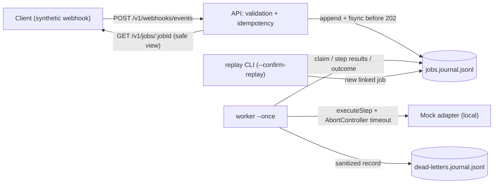

# durable-integration-worker-ts

A **tested local reference implementation** of durable webhook processing for integration workloads
(AI gateways, healthcare systems, fintech, SaaS APIs). It covers:
- webhook ingestion with strict validation and idempotency keys;
- durable job state in an append-only journal;
- bounded retries with deterministic backoff;
- timeout and failure classification;
- dead letters and restart recovery;
- structured logs with correlation IDs.

> **The claim, precisely:** durable, idempotency-aware, **at-least-once** processing in a
> **single-host, local-file** reference implementation, exercised by deterministic tests.

## Limits and disclaimer

- **Local only.** The API binds to `127.0.0.1`. There's no deployment, container or cloud configuration.
- **Synthetic events only.** The schema requires `source: "synthetic-demo"`. Never send real customer, medical or financial data.
- **Mock adapter only.** There are no external integrations, and the application makes no outbound network requests.
- **Not production-ready.** There's no authentication, multi-node operation, journal compaction or rotation, or load testing.
- **No exactly-once claim.** A crash after a side effect but before its journal record can repeat that step on retry. That's at-least-once.
- **No compliance claim.** This is not HIPAA, PCI or SOC 2 compliant or certified software.

The full list is in [`docs/limitations.md`](docs/limitations.md).

## Architecture



| Layer | Path | Responsibility |
|---|---|---|
| API | `src/api/` | Fastify routes, header and body validation (Zod, strict), safe errors, safe job view |
| Domain | `src/domain/` | State machine, reducer, backoff, failure classification, synthetic event schema |
| Persistence | `src/persistence/` | Journal append + fsync, rebuild, torn-tail handling, lock file, dead-letter journal |
| Adapters | `src/adapters/` | Typed step boundary and the deterministic local mock |
| Worker | `src/worker/` | Single-cycle worker, timeouts, retries, dead letters, stale-lease recovery, replay |
| Observability | `src/observability/` | Pino JSON logs, redaction, email/phone sanitizer |
| CLI | `src/cli/` | `api`, `worker --once`, `replay` entry points |

There's more in [`docs/architecture.md`](docs/architecture.md), including the correlation-ID flow.
Requirements and validation evidence live in
[`specs/2026-10-31-durable-integration-worker/`](specs/2026-10-31-durable-integration-worker/).

### Job state machine

```text
RECEIVED -> READY -> PROCESSING -> SUCCEEDED
                         |  \
                         |   -> RETRY_SCHEDULED -> READY
                         v
                    DEAD_LETTERED
```

## API (synthetic examples)

```bash
curl -s -X POST http://127.0.0.1:3000/v1/webhooks/events \
  -H 'content-type: application/json' \
  -H 'Idempotency-Key: demo-key-0000000001' \
  -H 'X-Correlation-ID: corr-demo-0001' \
  -d '{"eventId":"evt_DEMO000001","type":"synthetic.order.created","occurredAt":"2026-10-31T12:00:00Z",
       "source":"synthetic-demo","data":{"referenceId":"SYN-1001","amountMinor":1250,"currency":"USD"}}'
# 202 {"jobId":"<uuid>","state":"READY","created":true,"correlationId":"corr-demo-0001"}
# same key + same body  -> 200 {"jobId":"<same uuid>","created":false,...}
# same key + other body -> 409 IDEMPOTENCY_KEY_CONFLICT

curl -s http://127.0.0.1:3000/v1/jobs/<uuid>   # safe summary: state, attempt, steps, failureCategory... no payload
curl -s http://127.0.0.1:3000/healthz          # {"status":"ok"}
```

**Required headers:**
- `Idempotency-Key`: 16–128 chars of `[A-Za-z0-9._:-]`
- `X-Correlation-ID`: 8–128 chars of the same set

**Rejections:**

| Request | Response |
|---|---|
| Unknown fields (at any level) | `400 VALIDATION_ERROR`, with field paths only |
| Body over 16 KiB | `413` |
| Non-JSON body | `415` |
| Malformed JSON | `400 INVALID_JSON` |
| Persistence failure | `503 STORAGE_UNAVAILABLE`, never `202` |

## How it behaves

- **Idempotency.** The key is stored only as a SHA-256 hash, plus a canonical-JSON fingerprint of
  the body. One key maps to one job within a runtime directory. The index is rebuilt from the
  journal on startup.
- **Retries.** These outcomes are retryable:
  - `TIMEOUT` and `TRANSIENT`;
  - `RATE_LIMITED` (429-like) and `UPSTREAM_5XX`;
  - `ADAPTER_ERROR` (an unexpected throw, with its message discarded);
  - `WORKER_INTERRUPTED` (an expired lease).

  Validation and other 4xx-like outcomes are permanent. The retry delay is
  `min(MAX_BACKOFF_MS, BASE_BACKOFF_MS × 2^(attempt−1))`, with no jitter. `MAX_ATTEMPTS` (1–10) is
  server-owned; clients can't set limits, delays, states, paths or adapters.
- **Timeouts.** Each step runs under `JOB_TIMEOUT_MS` with an `AbortController`. On expiry the step is
  recorded as `TIMEOUT`, with no stack and no raw error text.
- **Partial failure.** Each completed step is journaled (`STEP_SUCCEEDED`). Retries, restarts and
  replays run only unfinished steps.
- **Dead letters.** A permanent failure, or the final failed attempt, moves the job to `DEAD_LETTERED` and
  appends a sanitized record to `dead-letters.journal.jsonl`; missing records are reconciled by the
  next cycle. Dead letters are never polled again. They can only be replayed deliberately:

  ```bash
  npm run replay:dead-letter -- --job-id <uuid> --confirm-replay
  ```

  Replay creates a **new** job with `replayOf`, and the original keeps `replayedAs`. There is no HTTP replay endpoint.
- **Restart recovery.** On startup the full journal is replayed. A `RETRY_SCHEDULED` job keeps its
  `nextAttemptAt`. A job stuck in `PROCESSING` past its lease is recovered as `WORKER_INTERRUPTED`.

## What the journal guarantees (and what it does not)

| Guarantees (in this local reference) | Does **not** guarantee |
|---|---|
| A `202` is sent only after `JOB_RECEIVED` + `READY` were written **and fsynced** | Durability beyond what the OS and disk honour for `fsync` |
| Every transition is fsynced before it is reported or acted on | Survival of disk loss or corruption from outside the process |
| Full state and idempotency rebuild from the journal on restart | Multi-host or multi-node safety (the lock file is local and advisory) |
| A torn final record is preserved, ignored, reported and acknowledged by a marker; history is never rewritten | Bounded file growth (no compaction or rotation) |
| Mid-file corruption refuses startup instead of guessing | No exactly-once side effects (delivery is at-least-once) |

Windows doesn't support directory `fsync`, so on Windows the durability of a newly created file's directory entry depends on the OS.

## Setup and verification

Requires Node.js 22.12+ or 24 (developed on 24.9.0) and npm. Dependencies are project-local.

```bash
npm ci
npm run typecheck
npm run lint
npm run check:safety   # static, doc and traceability checks
npm test               # 42 deterministic tests
npm run build
npm run smoke          # end-to-end: API + worker + restart, using a temp runtime dir
```

**Running it locally:**
- `npm run start:api` starts the API.
- `npm run worker:once` runs one worker cycle.
- Configuration comes from environment variables; see [`.env.example`](.env.example) for the non-secret settings.
- Runtime data goes to `.runtime/`, which is Git-ignored.

## Test coverage matrix

| Behaviour | Tests |
|---|---|
| Accept and persist before `202`; `503` on storage failure | `T-API-01`, `T-API-02`, `T-JR-01` |
| Schema, header, size, media-type and JSON rejection; no client control | `T-API-03`, `T-API-04`, `T-API-05`, `T-API-11` |
| Duplicate delivery → same job, one side effect; key conflict | `T-API-06`, `T-API-07` |
| Transient retry, timeout, permanent failure, max attempts | `T-WK-02`, `T-WK-03`, `T-WK-04`, `T-WK-05` |
| Partial failure resumes only the unfinished step | `T-WK-06`, `T-RP-02` |
| Restart rebuild, retry schedule after restart, stale lease | `T-WK-07`, `T-WK-08`, `T-WK-10` |
| Dead letters not polled; reconciliation; replay opt-in and audit link | `T-WK-09`, `T-WK-11`, `T-RP-01`–`T-RP-04` |
| Torn tail, mid-file corruption, lock file | `T-JR-02`, `T-JR-03`, `T-JR-04` |
| Log fields and redaction; safe job view | `T-LOG-01`–`T-LOG-03`, `T-API-08`, `T-API-10` |
| State machine, backoff, classification, config bounds | `T-SM-01`–`T-SM-03`, `T-BO-01`, `T-CL-01`, `T-CFG-01` |

Every requirement ID is mapped to evidence in
[`validation.md`](specs/2026-10-31-durable-integration-worker/validation.md).

## Demo walkthrough

A 3–5 minute, human-run terminal walkthrough is in [`docs/demo-walkthrough.md`](docs/demo-walkthrough.md).
It uses synthetic events and local state only.

## License

No license has been chosen yet; that is the owner's decision.
