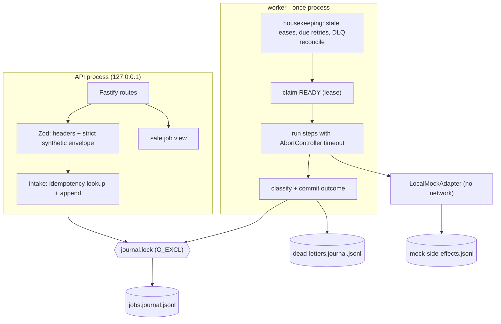

# Architecture

This document describes the tested local reference implementation as built. The authoritative
requirements are in [`../specs/2026-10-31-durable-integration-worker/`](../specs/2026-10-31-durable-integration-worker/).

## Components and boundaries

- **Domain** (`src/domain/`) is pure: the state machine, the immutable reducer, backoff and classification.
  The reducer rejects inconsistent events; the store treats that as rejection when appending and as
  corruption when reading.
- **Persistence** (`src/persistence/`):
  - `JournalFile` handles append + fsync and incremental reads.
  - `JobStore` keeps the in-memory projection and the idempotency index, takes the lock, and handles the torn tail.
  - `DeadLetterJournal` holds the operator-facing dead-letter records.
- **Adapters** (`src/adapters/`) are the typed step boundary. `LocalMockAdapter` is deterministic. Demo outcomes
  (`data.demoOutcome`) come from a closed enum and are honoured only when the server sets
  `MOCK_SCENARIOS_ENABLED=true`.
- **Worker** (`src/worker/`) runs one explicit cycle per invocation. Each step result is journaled before
  the next step starts.

## Journal format

There is one JSON object per line. Every record has `v` (schema version), `seq` (strictly increasing) and `at`. Record types:

| Type | Purpose |
|---|---|
| `JOB_RECEIVED` | Job identity, correlation ID, idempotency-key **hash**, request fingerprint, server `maxAttempts`, validated synthetic event; replay link and carried steps for replays |
| `JOB_TRANSITION` | `from` → `to`, `attempt`, `failureCategory`, `lastFailureCategory`, `nextAttemptAt` (retry), `leaseExpiresAt` (processing) |
| `STEP_SUCCEEDED` | Step completion for a specific attempt |
| `JOB_REPLAYED` | Audit link from a dead-lettered job to its replay |
| `JOURNAL_TAIL_RECOVERED` | Acknowledges an ignored torn final record by line number and byte count |

**Write path.** Writers take the lock file, refresh from the last consumed byte, validate the new
events against the projection, write once, then `fsync`. Only after that do they publish the new
projection and acknowledge the caller.

**Read path.** On open, every record is replayed through the reducer. API reads refresh incrementally
and never consume a trailing partial line, which may be another process writing at that moment.

## Torn-tail and corruption handling

1. If the final bytes have no newline, or the final complete line doesn't parse, they are treated as an interrupted write.
2. Those bytes are **left in place**.
3. Under the lock, the store appends a newline (if needed) plus a `JOURNAL_TAIL_RECOVERED` marker,
   and logs `journal_tail_ignored`.
4. Later opens see the malformed line followed by its marker and log `journal_tail_previously_recovered`.
5. Any other unparseable or invalid record, a non-increasing `seq`, or an impossible transition raises
   `JOURNAL_CORRUPT` and refuses startup. Nothing is auto-repaired or truncated.

## Concurrency model

- The API and the worker are separate processes on one host, and they coordinate through the
  `journal.lock` file (exclusive create).
- A lock older than `STALE_LOCK_MS` is considered abandoned and is broken, with a log entry.
- Within a process, a promise queue serializes store operations.
- This is **not** a distributed lock. Running more than one worker at a time is outside the tested scope.
- A worker that loses its lease (the job is no longer `PROCESSING` at the same attempt) logs
  `job_lease_lost` and does not commit.

## Correlation-ID flow

1. **Receipt.** `X-Correlation-ID` is validated (8–128 chars, `[A-Za-z0-9._:-]`). Invalid or missing values are rejected
   with `400` before anything is persisted. Valid IDs are echoed in error bodies.
2. **Acceptance.** The ID is stored in `JOB_RECEIVED`. `webhook_accepted` logs `{correlationId, jobId, state}`.
   A duplicate delivery logs `webhook_duplicate` with the *request's* correlation ID plus `originalCorrelationId`.
3. **Worker.** Every worker record for the job carries the stored `correlationId` and the `jobId`:
   `job_claimed`, `step_started`, `step_succeeded`, `step_failed` and `job_succeeded`. Each also has
   `attempt`, plus `state` or `failureCategory`. The adapter receives the correlation ID in its step context.
4. **Retry.** `job_retry_scheduled` (with `nextAttemptAt`) and `job_retry_due` keep the same correlation ID.
5. **Dead letter.** `job_dead_lettered` and the sanitized dead-letter record include the correlation ID.
6. **Recovery.** After a restart the correlation ID comes from the journal. `job_lease_expired_recovered`
   and `dead_letter_reconciled` include it.
7. **Replay.** The new job inherits the original correlation ID. `dead_letter_replayed` logs both job IDs.

## Logging and redaction

- Pino writes JSON lines with `service`, `level` and an ISO `time`.
- Routes never log bodies, headers or idempotency keys.
- Pino `redact` covers `body`, `payload`, `headers`, `authorization`, `idempotencyKey` and `stack` paths as a backstop.
- A sanitizer masks email- and phone-shaped substrings in free-text fields.
- Unknown errors are logged as `{ name }` only, without the message or stack.
